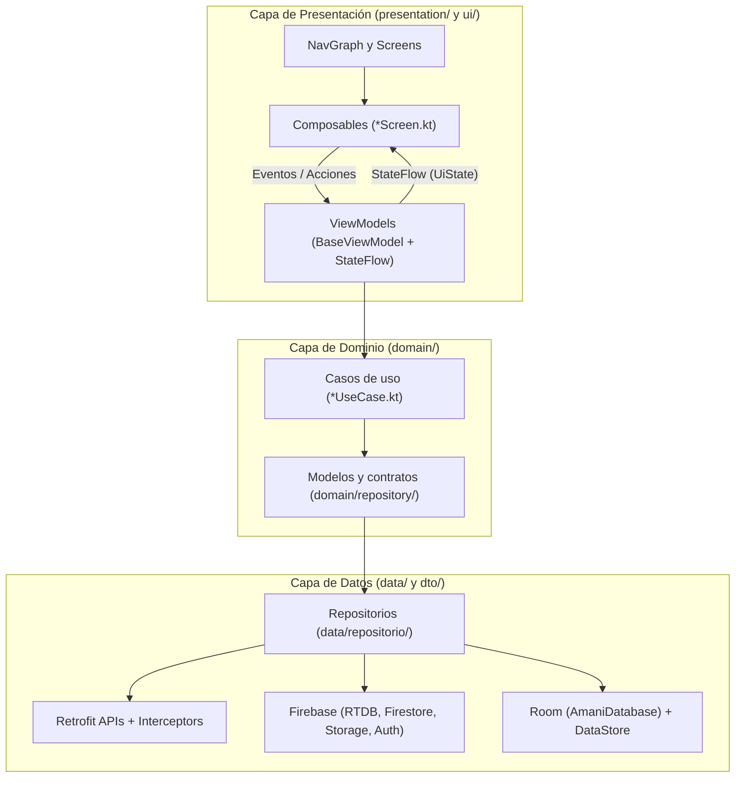

# Arquitectura

Esta página explica la arquitectura **Clean Architecture + MVVM** del módulo `:app`, el flujo unidireccional de datos (UDF) entre las capas [`presentation`](https://github.com/AmaniGrupo1/AmaniAndroid/tree/master/app/src/main/java/org/ies/tierno/applicationamani/presentation), [`domain`](https://github.com/AmaniGrupo1/AmaniAndroid/tree/master/app/src/main/java/org/ies/tierno/applicationamani/domain) y [`data`](https://github.com/AmaniGrupo1/AmaniAndroid/tree/master/app/src/main/java/org/ies/tierno/applicationamani/data), y las decisiones técnicas verificadas en el repositorio.

## Capas y flujo unidireccional de datos (UDF)

La aplicación se divide en tres capas concéntricas conectadas mediante inyección de dependencias con Koin ([`di/`](https://github.com/AmaniGrupo1/AmaniAndroid/tree/master/app/src/main/java/org/ies/tierno/applicationamani/di)):



1. **Presentación (`presentation/` y `ui/theme/`):** las pantallas en Jetpack Compose observan flujos `StateFlow` expuestos por los ViewModels (muchos de los cuales heredan de [`BaseViewModel`](https://github.com/AmaniGrupo1/AmaniAndroid/blob/master/app/src/main/java/org/ies/tierno/applicationamani/core/viewmodel/BaseViewModel.kt) para reportar excepciones no controladas a [`CrashReporter`](https://github.com/AmaniGrupo1/AmaniAndroid/blob/master/app/src/main/java/org/ies/tierno/applicationamani/core/crash/CrashReporter.kt)) y emiten acciones del usuario mediante llamadas a funciones del ViewModel.
2. **Dominio (`domain/`):** encapsula las reglas de negocio en 25 casos de uso (`domain/usecases/`), modelos de dominio (`domain/models/`) y el contrato [`ChatRepository`](https://github.com/AmaniGrupo1/AmaniAndroid/blob/master/app/src/main/java/org/ies/tierno/applicationamani/domain/repository/ChatRepository.kt).
3. **Datos (`data/` y `dto/`):** implementa los repositorios que coordinan las 16 interfaces Retrofit (`data/remoto/`), servicios Firebase, persistencia de sesión en DataStore y la base de datos local Room (`data/local/diario/`).

!!! note "Matices de la arquitectura real en el código"
    Aunque la estructura sigue Clean Architecture + MVVM, la mayoría de los repositorios (salvo `ChatRepository`) son clases concretas en `data/repositorio/` inyectadas directamente en los casos de uso o ViewModels sin interfaz intermedia en `domain/repository/`, y el paquete `dto/` se ubica en la raíz de `org.ies.tierno.applicationamani.dto`.

## Ejemplo real de flujo completo: Inicio de sesión

El flujo de autenticación recorre una única ruta de código desde la pantalla hasta el almacenamiento local y el backend:

1. **Pantalla ([`LoginScreen.kt`](https://github.com/AmaniGrupo1/AmaniAndroid/blob/master/app/src/main/java/org/ies/tierno/applicationamani/presentation/ui/screen/LoginScreen.kt)):** recoge correo y contraseña, observa `loginResult`, `isLoggingIn` y `loginError` desde [`LoginViewModel`](https://github.com/AmaniGrupo1/AmaniAndroid/blob/master/app/src/main/java/org/ies/tierno/applicationamani/presentation/viewmodels/LoginViewModel.kt), e invoca `loginViewModel.login()`.
2. **ViewModel ([`LoginViewModel.kt`](https://github.com/AmaniGrupo1/AmaniAndroid/blob/master/app/src/main/java/org/ies/tierno/applicationamani/presentation/viewmodels/LoginViewModel.kt)):** valida el formato de correo/contraseña e invoca a [`LoginUseCase`](https://github.com/AmaniGrupo1/AmaniAndroid/blob/master/app/src/main/java/org/ies/tierno/applicationamani/domain/usecases/login/LoginUseCase.kt) dentro de `viewModelScope`.
3. **Caso de uso ([`LoginUseCase.kt`](https://github.com/AmaniGrupo1/AmaniAndroid/blob/master/app/src/main/java/org/ies/tierno/applicationamani/domain/usecases/login/LoginUseCase.kt)):** delega la operación en [`AuthRepository.login()`](https://github.com/AmaniGrupo1/AmaniAndroid/blob/master/app/src/main/java/org/ies/tierno/applicationamani/data/repositorio/AuthRepository.kt).

```kotlin title="app/src/main/java/org/ies/tierno/applicationamani/domain/usecases/login/LoginUseCase.kt"
class LoginUseCase(
    private val repository: AuthRepository,
) {
    suspend fun login(request: LoginRequestDTO): Result<LoginResponseDTO> = repository.login(request)
    suspend fun registerPaciente(request: PacienteRequest): Result<LoginResponseDTO> = repository.registerPaciente(request)
    suspend fun registrarAdmin(request: RegistryPacienteDTO): Result<LoginResponseDTO> = repository.registerAdmin(request)
    suspend fun registrarPsicologo(request: PsicologoRequestDTO): Result<PsicologoSelfResponseDTO> = repository.registerPsicologo(request)
}
```

4. **Repositorio y fuentes de datos ([`AuthRepository.kt`](https://github.com/AmaniGrupo1/AmaniAndroid/blob/master/app/src/main/java/org/ies/tierno/applicationamani/data/repositorio/AuthRepository.kt)):** ejecuta `api.login(request)` en [`AuthApi`](https://github.com/AmaniGrupo1/AmaniAndroid/blob/master/app/src/main/java/org/ies/tierno/applicationamani/data/remoto/AuthApi.kt), persiste el JWT en [`TokenDataStore`](https://github.com/AmaniGrupo1/AmaniAndroid/blob/master/app/src/main/java/org/ies/tierno/applicationamani/data/local/TokenDataStore.kt), actualiza la caché en memoria [`TokenHolder`](https://github.com/AmaniGrupo1/AmaniAndroid/blob/master/app/src/main/java/org/ies/tierno/applicationamani/data/local/TokenHolder.kt), guarda el perfil en [`UserSessionDataStore`](https://github.com/AmaniGrupo1/AmaniAndroid/blob/master/app/src/main/java/org/ies/tierno/applicationamani/data/local/UserSessionDataStore.kt) y solicita `/api/auth/firebase-token` para autenticar en Firebase Auth.

```kotlin title="app/src/main/java/org/ies/tierno/applicationamani/data/repositorio/AuthRepository.kt"
if (body != null) {
    tokenDataStore.saveToken(body.token)
    tokenHolder.setToken(body.token)
    firebaseAuthManager.loginAnonymous()
    userSessionDataStore.saveSession(
        UserSession(
            idUsuario = body.idUsuario,
            nombre = body.nombre,
            rol = body.rol,
            email = request.email,
            idPsicologo = body.idPsicologo,
            idPaciente = body.idPaciente,
        ),
    )
}
```

## Decisiones arquitectónicas verificadas

- **Gestión de estado con `StateFlow`:** los ViewModels exponen flujos inmutables consumidos en Compose con `collectAsStateWithLifecycle()` o `collectAsState()`.
- **Separación de token en disco y memoria:** `TokenDataStore` persiste el JWT en disco de forma asíncrona, mientras que `TokenHolder` mantiene una copia en memoria (`@Volatile`) para que [`AuthInterceptor`](https://github.com/AmaniGrupo1/AmaniAndroid/blob/master/app/src/main/java/org/ies/tierno/applicationamani/data/remoto/AuthInterceptor.kt) adjunte la cabecera `Authorization: Bearer` sin bloquear el hilo de red.
- **Sincronización diferida del diario:** el diario emocional opera en modo *offline-first* sobre Room (`AmaniDatabase`) y encola un [`SyncDiarioWorker`](https://github.com/AmaniGrupo1/AmaniAndroid/blob/master/app/src/main/java/org/ies/tierno/applicationamani/data/remoto/SyncDiarioWorker.kt) en WorkManager con restricción de conectividad (`NetworkType.CONNECTED`).
- **Sistema de diseño propio sobre Material 3:** [`DECISIONES.md`](https://github.com/AmaniGrupo1/AmaniAndroid/blob/master/DECISIONES.md) documenta la desactivación de Dynamic Color (`DEC-02`) y la creación de `LocalAmaniColors` (`DEC-05`) para garantizar contraste WCAG AA.

<!-- TODO: confirmar el motivo histórico de elegir Koin frente a Hilt y Retrofit frente a Ktor si existe documentación previa del equipo -->

## Siguientes pasos

- Revisa la [Estructura del proyecto](estructura-proyecto.md) para ver el árbol completo de paquetes.
- Consulta la [Capa UI](capa-ui.md) y [Navegación](navegacion.md) para profundizar en la presentación.
- Explora [Inyección de dependencias](inyeccion-dependencias.md) para ver cómo Koin conecta estas capas.

*[MVVM]: Model-View-ViewModel
*[UDF]: Unidirectional Data Flow (Flujo de datos unidireccional)
*[JWT]: JSON Web Token
*[RTDB]: Firebase Realtime Database
*[WCAG]: Web Content Accessibility Guidelines
