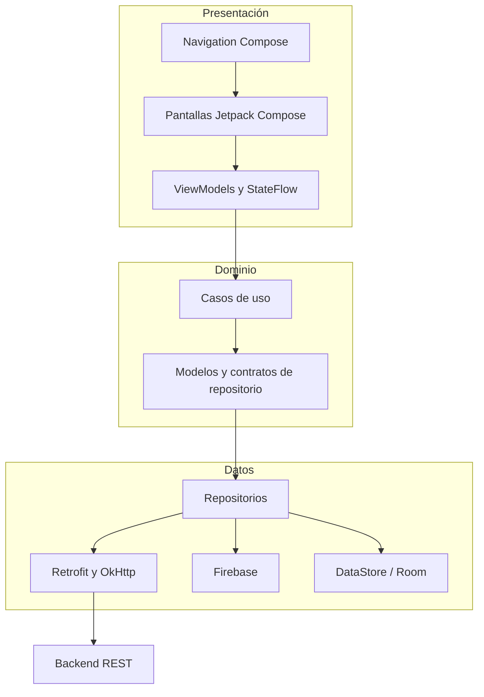

# Arquitectura

La aplicación es un único módulo Android (`:app`) organizado en paquetes por capas. El flujo de presentación combina pantallas Compose y ViewModels; el dominio contiene modelos, contratos de repositorio y casos de uso; los repositorios de datos conectan los servicios remotos y el almacenamiento local.

## Componentes y flujo de datos

`Backend REST` representa una dependencia externa: este repositorio contiene el cliente Retrofit, no el servidor.

## Inyección de dependencias

`AmaniApplication` inicia Koin con `appModule`, `retrofitModule`, `crashModule`, `chatModule` y `gameModule`. `RetrofitModule` crea un cliente HTTP y registra interfaces Retrofit; `AppModule` registra repositorios, casos de uso y ViewModels.

## Integraciones y almacenamiento

- **REST:** Retrofit y Gson; OkHttp añade interceptores de autenticación, actualización de token y reporte a Crashlytics.
- **Firebase:** el proyecto configura Auth, Firestore, Realtime Database, Storage, mensajería y Crashlytics/Performance.
- **Sesión:** DataStore Preferences guarda el token JWT y los datos de sesión.
- **Diario:** Room conserva entradas locales; WorkManager encola la sincronización con el backend cuando hay conectividad.
- **Video y pagos:** hay dependencias y código cliente para Jitsi y Stripe. La disponibilidad de servicios y credenciales depende del entorno.

## Decisiones respaldadas por el repositorio

`DECISIONES.md` registra decisiones de UI/materiales, no una comparación completa de alternativas para la arquitectura:

- Material 3 y el tema de la app concentran tokens de color, tipografía y formas. El documento de decisiones favorece desactivar Dynamic Color para mantener la identidad visual.
- El diseño documenta Nunito y Roboto como las dos familias tipográficas objetivo.
- Koin, Retrofit y Firebase son las tecnologías que están integradas actualmente. No se encontró una decisión de arquitectura que explique la selección frente a Hilt, Ktor u otras alternativas.

<!-- TODO: documentar el motivo histórico de elegir Koin, Retrofit y Firebase si existe una decisión verificable fuera de este repositorio -->

No se presentan como decisiones históricas razones que no estén registradas. Consulta [Limitaciones y roadmap](limitaciones-y-roadmap.md) para las discrepancias conocidas.

## Siguientes pasos

Revisa [datos y persistencia](referencia/datos-y-persistencia.md), la [API](referencia/api-endpoints.md) y [seguridad y alcance](seguridad-y-alcance.md).
