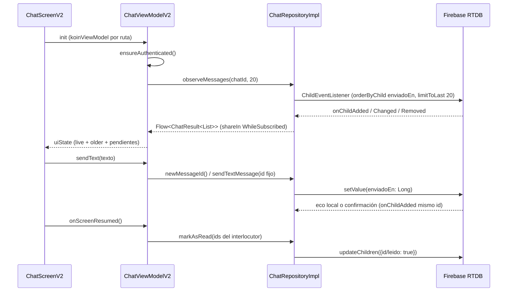

# Auditoría y refuerzo del chat

Resumen de la auditoría del chat de mensajería (stack V2: `ChatListScreen` → `ChatScreenV2` → `ChatViewModelV2` → `data/repository/ChatRepositoryImpl`, sobre Firebase Realtime Database y Storage, con Koin).

!!! warning "Verificación pendiente"
    Los cambios se han revisado de forma estática. En el entorno de la auditoría no hay Android SDK ni acceso a los repositorios de Gradle (`./gradlew` falla al resolver plugins), así que **no se ha compilado ni ejecutado ningún test**. Ejecuta `./gradlew :app:testDebugUnitTest` en CI o en local antes de integrar.

## Diagnóstico inicial

- El stack V1 (`ChatScreen`, `ChatViewModel`, `data/repositorio/*`, `ChatFirebaseService`, `ChatApi`, casos de uso de `generalizado`) no está registrado en Koin ni referenciado desde `main`; solo lo ejercitan tests y `docs/README-CHAT-DIARIO.md`.
- V2 escribe directamente en RTDB (`chats/{min}_{max}/messages/{id}`) y no pasa por `POST /api/chats/messages`.
- La sala se calcula en `NavGraph` como `{min}_{max}` de los `idUsuario`.

## Flujo de un mensaje (V2)

## Tabla de auditoría

| ID | Problema | Sev. | Evidencia | Solución | Estado |
|---|---|---|---|---|---|
| A1 | Reglas desplegadas abiertas a cualquier usuario autenticado; `idSender` sin ligar a `auth.uid` | P0 | `firebase-database-rules.json`, `storage.rules`, `firestore.rules` | Propuesta `firebase-database-rules.proposed.json` y `storage.rules.proposed` | **Pendiente**: no desplegada; requiere confirmar el UID del custom token y probar en emulador |
| A2 | `currentUserId` tomado de la ruta | P0 | `NavGraph.kt` (ruta `chat`) | Se exige que coincida con `session.idUsuario` | Implementado (sin ejecutar) |
| B1 | `enviadoEn` escrito como String; tipos mixtos rompen `limitToLast`/`endAt` | P1 | `ChatRepositoryImpl` | Escritura `Long`; `parseTimestamp` tolerante (Long/String/ISO) | Implementado; datos legacy en String siguen ordenándose mal hasta migrarlos |
| B2 | Historial paginado se perdía al llegar un mensaje | P1 | `ChatViewModelV2.observeMessages` | Fuentes separadas `live`/`older`/`pendientes` | Implementado, con test |
| B3 | Mensajes FAILED desaparecían; sin reintento real | P1 | `ChatViewModelV2`, `ChatScreenV2` | `retrySend(id)` idempotente (id = clave Firebase) + botón en burbuja | Implementado, con test |
| B4 | Disparador de paginación apuntaba al extremo equivocado con `reverseLayout` | P1 | `ChatScreenV2` | Basado en último ítem visible | Implementado |
| B5 | Auto-scroll siempre, sin aviso de nuevos | P1 | `ChatViewModelV2`/`ChatScreenV2` | Scroll solo si está cerca del final o es propio; chip «Mensajes nuevos» | Implementado |
| B6 | Sin marcado de lectura, sin refresco de sesión Firebase, errores no visibles | P1 | VM/pantalla | `markAsRead` multi-ruta, `ensureAuthenticated`, snackbar de error | Implementado, con test |
| B7 | Tick «entregado» para todo mensaje enviado | P1 | `ChatScreenV2` | Solo enviado/leído | Implementado |
| B8 | Caché de flujos: `remove` incondicional, `pageSize` ignorado; spinner colgado si el listener inicial se cancela | P2 | `ChatRepositoryImpl` | Clave `chatId#pageSize`, `replayExpirationMillis=0`, cierre con error | Implementado |
| B9 | `AudioHandler` sin `release()`; audio sigue al salir; archivo vacío se enviaba | P2 | `ChatScreenV2` | `DisposableEffect`, pausa en `ON_PAUSE`, comprobación de tamaño | Implementado |
| B10 | FCM no cableado (token no registrado, sin `POST_NOTIFICATIONS` en chat) | P2 | `AmaniFirebaseMessagingService` | Requiere backend | Pendiente |
| B11 | Stack V1 muerto, dos `ChatRepository` con nombre casi igual | P3 | varios | Ver DEC-12 | Pendiente |

## Estados de mensaje

| Estado | Significado | Evidencia |
|---|---|---|
| `SENDING` | Insertado localmente, aún no devuelto por el listener | estado local |
| `SENT` | Presente en el listener (eco local de RTDB o confirmación) | `onChildAdded` |
| `READ` | El otro participante puso `leido=true` | campo `leido` |
| `FAILED` | `setValue` devolvió error | excepción del SDK |

`DELIVERED` no se emite: RTDB no informa de entrega al dispositivo destino. Con persistencia offline el eco local hace que un mensaje aparezca como `SENT` antes de llegar al servidor.

## Ciclo de vida de listeners

El `ChildEventListener` vive en un `callbackFlow` compartido con `shareIn(WhileSubscribed(5 s, replayExpiration 0))`. El ViewModel lo recoge en `viewModelScope`; al limpiarse el ViewModel y pasar 5 s, `awaitClose` retira el listener y desactiva `keepSynced`.

## Pruebas

- Añadidas: `ChatViewModelV2Test` (envío, vacío, longitud, duplicados, FAILED+retry, páginas antiguas, `hasMore`, lectura, error, sesión) y `ParseTimestampTest`. Usan un `FakeChatRepository` en memoria: no tocan Firebase.
- No ejecutadas (ver aviso).
- Sin cubrir: tests de UI (`androidTest`), pruebas de reglas con el emulador de Firebase y pruebas del repositorio contra RTDB.

## Migración de mensajes legacy (propuesta, no ejecutada)

Los nodos con `enviadoEn` String/ISO deben convertirse a número. Plan: script de administración con el emulador primero; copia previa de `chats/`; reversión restaurando la copia. No se ha ejecutado ninguna migración.

## Siguientes pasos

- Confirma con el backend el formato de `auth.uid` y prueba `firebase-database-rules.proposed.json` en el emulador antes de desplegarla.
- Revisa [Seguridad y privacidad](seguridad-y-alcance.md) y [Decisiones y roadmap](limitaciones-y-roadmap.md).
