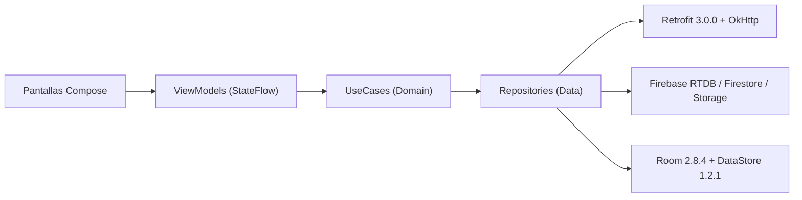

# Documentación del cliente Android

Cliente Android nativo (`v2.4`) para consultas psicológicas, agenda, diario emocional y chat entre pacientes, psicólogos y administración.

[Empezar :material-arrow-right:](puesta-en-marcha.md){ .md-button .md-button--primary }
[Ver en GitHub :fontawesome-brands-github:](https://github.com/AmaniGrupo1/AmaniAndroid){ .md-button }

minSdk 25
targetSdk 36
Kotlin 2.2.10
Compose BOM 2026.04.01
Koin 4.1.1
43 rutas

Documentación del módulo `:app` (`org.ies.tierno.applicationamani`). Las versiones salen de [`gradle/libs.versions.toml`](https://github.com/AmaniGrupo1/AmaniAndroid/blob/master/gradle/libs.versions.toml) y [`app/build.gradle.kts`](https://github.com/AmaniGrupo1/AmaniAndroid/blob/master/app/build.gradle.kts).

-   :material-rocket-launch:{ .lg .middle } **Primeros pasos**

    ---

    JDK 17, Android SDK API 36, secretos locales, compilación y pruebas.

    [:octicons-arrow-right-24: Puesta en marcha](puesta-en-marcha.md)

-   :material-sitemap:{ .lg .middle } **Arquitectura**

    ---

    Clean + MVVM, flujo unidireccional y paquetes del módulo `:app`.

    [:octicons-arrow-right-24: Ver arquitectura](arquitectura.md)

-   :material-cellphone:{ .lg .middle } **UI y navegación**

    ---

    Material 3 (`AppTheme`), pantallas Compose por rol y grafo de 43 rutas.

    [:octicons-arrow-right-24: Ver capa UI](capa-ui.md)

-   :material-database-sync-outline:{ .lg .middle } **Datos, API y DI**

    ---

    Retrofit, diario offline con Room + WorkManager y módulos Koin.

    [:octicons-arrow-right-24: Ver capa de datos](referencia/datos-y-persistencia.md)

-   :material-flask-outline:{ .lg .middle } **Calidad y entrega**

    ---

    Suites unitarias, Test Lab, APK firmado, permisos y tokens.

    [:octicons-arrow-right-24: Ver testing](calidad-y-testing.md)

-   :material-compass-outline:{ .lg .middle } **Decisiones**

    ---

    `DEC-01` a `DEC-10`, limitaciones, roadmap y mantenimiento de docs.

    [:octicons-arrow-right-24: Ver decisiones](limitaciones-y-roadmap.md)

## Qué cubre cada rol

-   :material-account-heart:{ .lg .middle } **Paciente**

    ---

    Cuestionario, citas y pago Stripe, Jitsi, chat con adjuntos, diario offline, historial y tickets.

-   :material-account-tie:{ .lg .middle } **Psicólogo**

    ---

    Agenda, horarios, alta de pacientes, historial clínico, chat, estadísticas Vico y perfil.

-   :material-shield-account:{ .lg .middle } **Administración**

    ---

    Altas, roles, asignación de psicólogo, tests, terapias, situaciones y documentos legales.

## Flujo de arquitectura

!!! note "Alcance del repositorio"
    Este repositorio es el cliente Android (`:app`). El servidor REST en Cloud Run vive aparte. Tabla de versiones: [Build y configuración](referencia/configuracion.md). Capturas: [Demo y capturas](demo-y-capturas.md).

## Siguientes pasos

- Compila en local con [Puesta en marcha](puesta-en-marcha.md).
- Recorre paquetes en [Arquitectura](arquitectura.md) y [Estructura del proyecto](estructura-proyecto.md).

*[REST]: Representational State Transfer
*[MVVM]: Model-View-ViewModel
*[UDF]: Unidirectional Data Flow (Flujo de datos unidireccional)
*[DI]: Dependency Injection (Inyección de dependencias)
*[SDK]: Software Development Kit
*[JDK]: Java Development Kit
*[AGP]: Android Gradle Plugin
*[BOM]: Bill of Materials
*[RTDB]: Firebase Realtime Database
*[APK]: Android Package Kit
