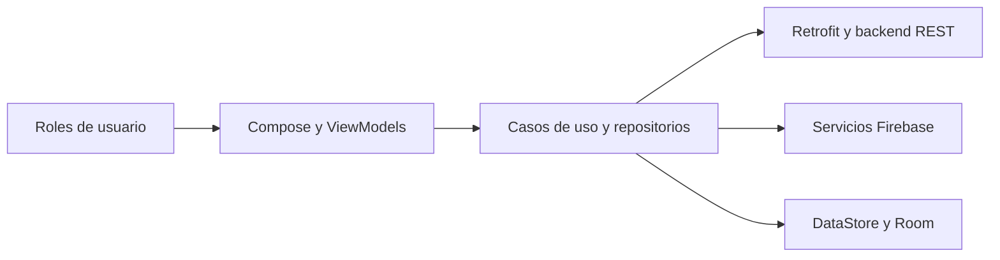

# Amani Android en 60 segundos

Amani es una aplicación Android para apoyar la gestión de consultas psicológicas. Conecta los flujos de pacientes, psicólogos y administración mediante una app nativa; la aplicación cliente consume un backend REST y servicios Firebase.

## El proyecto de un vistazo

| Tema | Estado comprobable |
|---|---|
| Problema | Reunir en una app tareas de consulta, seguimiento y comunicación entre los roles de Amani. |
| Aplicación | Kotlin, una app Gradle (`:app`), Jetpack Compose y Material 3. |
| Arquitectura | Capas de presentación, dominio y datos con MVVM; dependencias gestionadas con Koin. |
| Integraciones | Retrofit/OkHttp, Firebase, Room y WorkManager; también hay dependencias de Jitsi y Stripe. |
| Android | `minSdk 25`, `compileSdk 36` y `targetSdk 36`. |
| Ejecución local | JDK 17 y Android SDK con API 36; compila con `./gradlew assembleDebug`. |

## Funcionalidades presentes en el código

- Inicio de sesión y flujos de usuario para administrador, psicólogo y paciente.
- Gestión de perfiles, agenda/citas, cuestionarios, historial clínico y documentos legales.
- Chat, notificaciones y diario emocional; el diario dispone de persistencia local y sincronización.
- Pantallas de soporte, ajustes, estadísticas y pagos.

La presencia de una pantalla o interfaz cliente no garantiza que todos los flujos estén disponibles en un entorno de prueba. El backend y sus datos no se versionan en este repositorio.

## Enlaces rápidos

- [Demo y capturas](demo-y-capturas.md)
- [Arquitectura y decisiones](arquitectura.md)
- [Puesta en marcha local](puesta-en-marcha.md)
- [API consumida por la app](referencia/api-endpoints.md)
- [Testing y calidad](calidad-y-testing.md)
- [Limitaciones y roadmap](limitaciones-y-roadmap.md)
- [Sobre el proyecto](sobre-el-proyecto.md)
- [Contribuir a la documentación](contribuir-documentacion.md)

## Flujo simplificado

## Siguientes pasos

Empieza por la [puesta en marcha](puesta-en-marcha.md), consulta la [arquitectura](arquitectura.md) o revisa [demo y capturas](demo-y-capturas.md).
