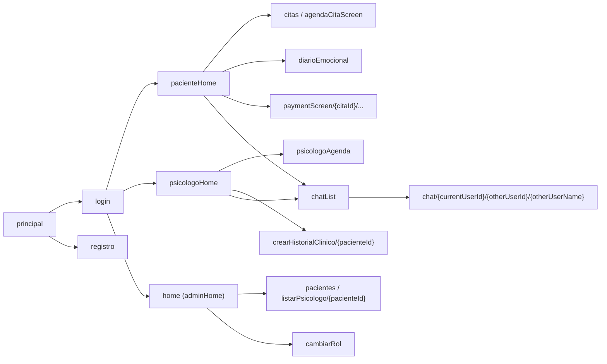

# Navegación

Esta página documenta la arquitectura de navegación implementada con **Jetpack Navigation Compose (`2.9.7`)**, cubriendo las rutas declaradas en [`Screens.kt`](https://github.com/AmaniGrupo1/AmaniAndroid/blob/master/app/src/main/java/org/ies/tierno/applicationamani/presentation/navigation/screen/Screens.kt), el contenedor principal [`NavGraph.kt`](https://github.com/AmaniGrupo1/AmaniAndroid/blob/master/app/src/main/java/org/ies/tierno/applicationamani/presentation/navigation/navGraph/NavGraph.kt) y las extensiones seguras en [`NavExtensions.kt`](https://github.com/AmaniGrupo1/AmaniAndroid/blob/master/app/src/main/java/org/ies/tierno/applicationamani/presentation/navigation/NavExtensions.kt).

## Grafo principal y bifurcación por rol

El punto de partida (`startDestination`) en [`NavGraph`](https://github.com/AmaniGrupo1/AmaniAndroid/blob/master/app/src/main/java/org/ies/tierno/applicationamani/presentation/navigation/navGraph/NavGraph.kt) es `Screens.principal.route` (`"principal"`). Tras autenticarse o restaurar la sesión desde [`UserSessionDataStore`](https://github.com/AmaniGrupo1/AmaniAndroid/blob/master/app/src/main/java/org/ies/tierno/applicationamani/data/local/UserSessionDataStore.kt), el usuario navega al panel de su rol:



## Rutas con argumentos y codificación segura

[`Screens`](https://github.com/AmaniGrupo1/AmaniAndroid/blob/master/app/src/main/java/org/ies/tierno/applicationamani/presentation/navigation/screen/Screens.kt) es una `sealed class` con **43 destinos** (42 registrados en `NavGraph.kt`; `Screens.settingsPsicologo` y `Screens.settingPsicologo` coexisten apuntando a `SettingsPsychologistScreen`). Las rutas parametrizadas exponen funciones factoría que aplican `Uri.encode()` cuando los argumentos contienen texto libre o fechas:

| Objeto en `Screens` | Patrón de ruta | Argumentos (`NavType`) |
|---|---|---|
| `listarPsicologo` | `listarPsicologo/{pacienteId}` | `pacienteId` (`LongType`) |
| `documentoLegalDetail` | `documento_legal_detail/{tipo}` | `tipo` (`StringType`, fallback `"terminos"`) |
| `perfilPsicologo` | `perfilPsicologo/{psicologoId}` | `psicologoId` (`LongType`) |
| `chat` | `chat/{currentUserId}/{otherUserId}/{otherUserName}` | `currentUserId` (`LongType`), `otherUserId` (`LongType`), `otherUserName` (`StringType` codificado con `Uri.encode`) |
| `editarCitaScreen` | `editarCitaScreen/{citaId}` | `citaId` (`StringType`) |
| `paymentScreen` | `paymentScreen/{citaId}/{psicologoName}/{fecha}/{monto}` | `citaId` (`LongType`), `psicologoName`, `fecha`, `monto` (`StringType` codificados) |
| `editProfilePsicologo` | `editProfilePsicologo/{identificador}` | `identificador` (`String` convertido con `toLongOrNull()`) |
| `historialClinico` / `crearHistorialClinico` | `historialClinico/{pacienteId}` / `crearHistorialClinico/{pacienteId}` | `pacienteId` (`LongType`) |
| `profileAdmin` / `perfilPaciente` | `profileAdmin/{adminId}` / `perfilPaciente/{pacienteId}` | `adminId` / `pacienteId` (`LongType`) |

```kotlin title="app/src/main/java/org/ies/tierno/applicationamani/presentation/navigation/screen/Screens.kt"
object chat : Screens("chat/{currentUserId}/{otherUserId}/{otherUserName}") {
    fun createRoute(
        currentUserId: Long,
        otherUserId: Long,
        otherUserName: String,
    ): String {
        val encodedName = Uri.encode(otherUserName)
        return "chat/$currentUserId/$otherUserId/$encodedName"
    }
}
```

## Barra inferior adaptativa y trazabilidad de navegación

`NavGraph` envuelve el `NavHost` en un `Scaffold` cuya `bottomBar` renderiza [`AmaniBottomBar`](https://github.com/AmaniGrupo1/AmaniAndroid/blob/master/app/src/main/java/org/ies/tierno/applicationamani/presentation/ui/componente/AmaniBottomBar.kt) según el rol activo (`BottomBarConfig.Admin`, `Psicologo` o `Paciente`) y se oculta automáticamente en `principal`, `login`, `registro` y cualquier ruta que comience por `"chat"`.

Además, registra un `OnDestinationChangedListener` que envía breadcrumbs a [`CrashReporter`](https://github.com/AmaniGrupo1/AmaniAndroid/blob/master/app/src/main/java/org/ies/tierno/applicationamani/core/crash/CrashReporter.kt) enmascarando cualquier argumento cuyo nombre contenga `password` o `token`:

```kotlin title="app/src/main/java/org/ies/tierno/applicationamani/presentation/navigation/navGraph/NavGraph.kt"
val listener = NavController.OnDestinationChangedListener { _, destination, arguments ->
    val screenName = destination.route ?: "Unknown_Screen"
    val safeArgs = arguments?.keySet()?.associateWith { key ->
        if (key.contains("password", true) || key.contains("token", true)) "***"
        else arguments.get(key).toString()
    }
    crashReporter.logNavigationEvent(screenName, safeArgs)
    crashReporter.logBreadcrumb("Navigated to $screenName")
}
```

!!! note "Deep links"
    Ni [`AndroidManifest.xml`](https://github.com/AmaniGrupo1/AmaniAndroid/blob/master/app/src/main/AndroidManifest.xml) ni [`NavGraph.kt`](https://github.com/AmaniGrupo1/AmaniAndroid/blob/master/app/src/main/java/org/ies/tierno/applicationamani/presentation/navigation/navGraph/NavGraph.kt) declaran esquemas `navDeepLink` externos actualmente; toda la navegación es interna a la aplicación.

## Ejemplo real de navegación parametrizada: Sala de chat

Cuando el usuario selecciona una conversación en [`ChatListScreen`](https://github.com/AmaniGrupo1/AmaniAndroid/blob/master/app/src/main/java/org/ies/tierno/applicationamani/presentation/ui/screen/chat/ChatListScreen.kt), navega a `Screens.chat.createRoute(currentUserId, otherUserId, otherUserName)`. En `NavGraph.kt`, el bloque `composable(Screens.chat.route)` valida que ambos IDs sean positivos, calcula el identificador determinista de sala `"{minId}_{maxId}"` e inyecta [`ChatViewModelV2`](https://github.com/AmaniGrupo1/AmaniAndroid/blob/master/app/src/main/java/org/ies/tierno/applicationamani/presentation/viewmodels/chat/ChatViewModelV2.kt) mediante `parametersOf(chatId, currentUserId.toString(), otherUserId.toString())`.

## Siguientes pasos

- Consulta [Capa UI](capa-ui.md) para ver el detalle de las pantallas y componentes.
- Revisa [Inyección de dependencias](inyeccion-dependencias.md) para ver cómo `ChatModule` resuelve los parámetros de navegación en `ChatViewModelV2`.

*[URI]: Uniform Resource Identifier
*[UI]: User Interface (Interfaz de usuario)
