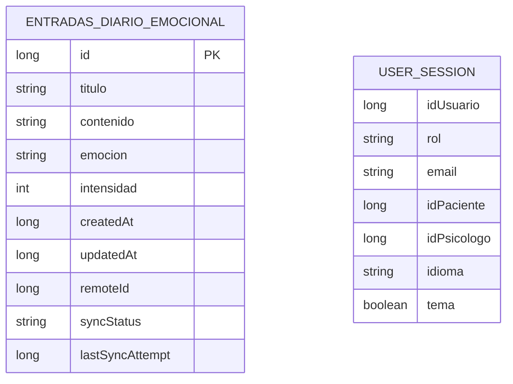

# Datos y persistencia

Este repositorio es el cliente Android; no incluye el esquema relacional ni las entidades del backend. La descripción de abajo se limita a estructuras locales y modelos visibles en el código de la app.

## Persistencia local

### Room: diario emocional

`AmaniDatabase` declara Room versión 2 y una entidad: `entradas_diario_emocional`. `EntradaDiarioEntity` incluye:

| Campo | Tipo/uso |
|---|---|
| `id` | Clave primaria local autogenerada (`Long`). |
| `titulo`, `contenido`, `emocion` | Texto de la entrada. |
| `intensidad` | Intensidad numérica. |
| `createdAt`, `updatedAt` | Marcas de tiempo en milisegundos epoch. |
| `remoteId` | ID asignado al sincronizar con el servidor; puede faltar. |
| `syncStatus` | Estado local de sincronización. |
| `lastSyncAttempt` | Marca de tiempo del último intento; puede faltar. |

La migración 1→2 añade `remoteId`, `syncStatus` y `lastSyncAttempt`. El DAO observa entradas con `Flow`; el manager de sincronización usa estados pendientes para crear, actualizar o borrar registros remotos y reconcilia entradas descargadas comparando marcas de tiempo.

### DataStore Preferences

- `TokenDataStore` almacena `jwt_token` en el DataStore `auth_prefs`.
- `UserSessionDataStore` almacena identificadores de usuario/paciente/psicólogo, rol, email, idioma y preferencia de tema en `user_session_prefs`.

El código no documenta un esquema local del backend ni una política de retención/backup.

## Modelo de relaciones

El modelo siguiente refleja solo lo que está explícito en el código local:

`USER_SESSION` representa valores guardados como preferencias, no una tabla Room ni una relación SQL. No se muestran columnas del servidor.

<!-- TODO: documentar el contrato/modelo de datos remoto desde una fuente backend aprobada -->

## Siguientes pasos

Consulta los [endpoints](api-endpoints.md) o la [configuración](configuracion.md).
