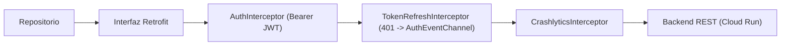
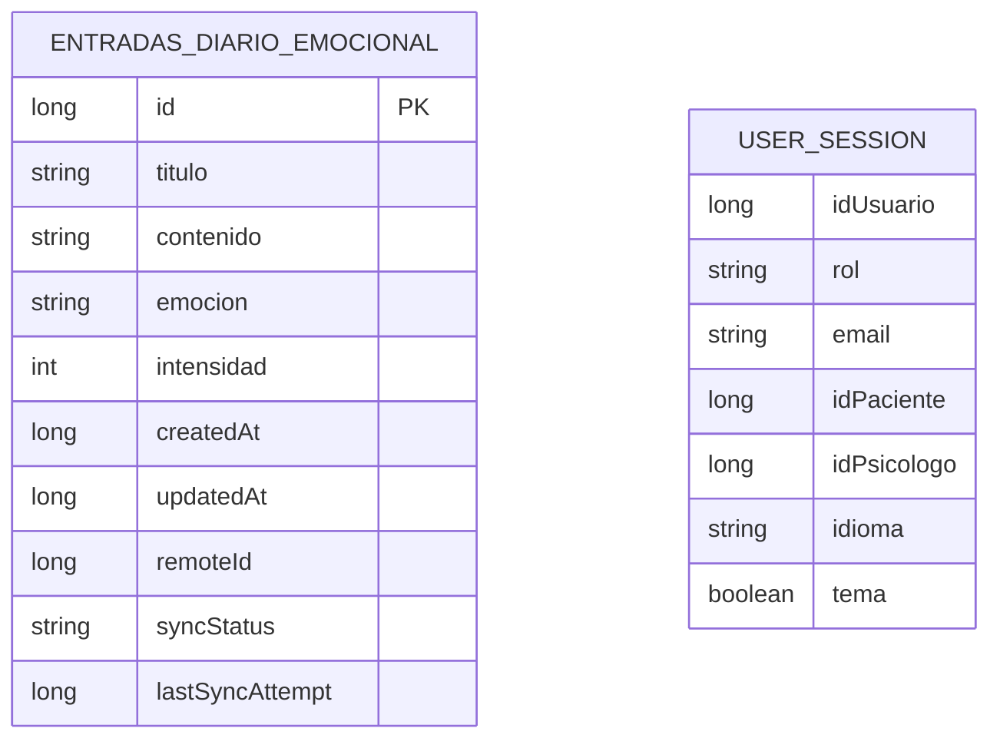

# Capa de datos y persistencia

Esta página describe la capa de datos del cliente Android ubicada en [`data/`](https://github.com/AmaniGrupo1/AmaniAndroid/tree/master/app/src/main/java/org/ies/tierno/applicationamani/data) y [`dto/`](https://github.com/AmaniGrupo1/AmaniAndroid/tree/master/app/src/main/java/org/ies/tierno/applicationamani/dto), abarcando la tubería de red con Retrofit/OkHttp, la integración con Firebase, el mapeo DTO a dominio y el almacenamiento local con Room (`2.8.4`) y DataStore (`1.2.1`).

## Red remota: Retrofit, OkHttp e interceptores

[`RetrofitModule.kt`](https://github.com/AmaniGrupo1/AmaniAndroid/blob/master/app/src/main/java/org/ies/tierno/applicationamani/di/RetrofitModule.kt) construye una instancia de `OkHttpClient` con timeouts de 60 segundos y encadena tres interceptores de aplicación antes de conectar con las 16 interfaces de [`data/remoto/`](https://github.com/AmaniGrupo1/AmaniAndroid/tree/master/app/src/main/java/org/ies/tierno/applicationamani/data/remoto):



- **[`AuthInterceptor`](https://github.com/AmaniGrupo1/AmaniAndroid/blob/master/app/src/main/java/org/ies/tierno/applicationamani/data/remoto/AuthInterceptor.kt):** lee el token desde la caché en memoria [`TokenHolder`](https://github.com/AmaniGrupo1/AmaniAndroid/blob/master/app/src/main/java/org/ies/tierno/applicationamani/data/local/TokenHolder.kt) y añade la cabecera `Authorization: Bearer <token>`.
- **[`TokenRefreshInterceptor`](https://github.com/AmaniGrupo1/AmaniAndroid/blob/master/app/src/main/java/org/ies/tierno/applicationamani/data/remoto/TokenRefreshInterceptor.kt):** detecta respuestas HTTP `401` y emite `AuthEvent.Unauthorized` en [`AuthEventChannel`](https://github.com/AmaniGrupo1/AmaniAndroid/blob/master/app/src/main/java/org/ies/tierno/applicationamani/data/local/AuthEventChannel.kt) para cerrar la sesión.
- **[`CrashlyticsInterceptor`](https://github.com/AmaniGrupo1/AmaniAndroid/blob/master/app/src/main/java/org/ies/tierno/applicationamani/data/remoto/CrashlyticsInterceptor.kt):** registra errores de red e información diagnóstica en [`CrashReporter`](https://github.com/AmaniGrupo1/AmaniAndroid/blob/master/app/src/main/java/org/ies/tierno/applicationamani/core/crash/CrashReporter.kt).
- **Servicios Firebase:** [`ChatRepositoryImpl`](https://github.com/AmaniGrupo1/AmaniAndroid/blob/master/app/src/main/java/org/ies/tierno/applicationamani/data/repository/ChatRepositoryImpl.kt) utiliza **Firebase Realtime Database** (`22.0.1`) para mensajes, estados de lectura (`delivered`/`read`) e indicadores `typing`, y **Firebase Storage** (`21.0.1`) para adjuntos multimedia.

## Persistencia local: Room (`AmaniDatabase` v2) y DataStore

### Room: Diario emocional y migraciones

[`AmaniDatabase`](https://github.com/AmaniGrupo1/AmaniAndroid/blob/master/app/src/main/java/org/ies/tierno/applicationamani/data/local/diario/AmaniDatabase.kt) declara Room en `version = 2` (`exportSchema = false`) con la entidad [`EntradaDiarioEntity`](https://github.com/AmaniGrupo1/AmaniAndroid/blob/master/app/src/main/java/org/ies/tierno/applicationamani/data/local/diario/EntradaDiarioEntity.kt) (`tableName = "entradas_diario_emocional"`) y el DAO [`DiarioEmocionalDao`](https://github.com/AmaniGrupo1/AmaniAndroid/blob/master/app/src/main/java/org/ies/tierno/applicationamani/data/local/diario/DiarioEmocionalDao.kt):

```kotlin title="app/src/main/java/org/ies/tierno/applicationamani/data/local/diario/AmaniDatabase.kt"
val MIGRATION_1_2 =
    object : Migration(1, 2) {
        override fun migrate(db: SupportSQLiteDatabase) {
            db.execSQL("ALTER TABLE entradas_diario_emocional ADD COLUMN remoteId INTEGER")
            db.execSQL("ALTER TABLE entradas_diario_emocional ADD COLUMN syncStatus TEXT NOT NULL DEFAULT 'SYNCED'")
            db.execSQL("ALTER TABLE entradas_diario_emocional ADD COLUMN lastSyncAttempt INTEGER")
        }
    }
```

### DataStore Preferences

- **[`TokenDataStore`](https://github.com/AmaniGrupo1/AmaniAndroid/blob/master/app/src/main/java/org/ies/tierno/applicationamani/data/local/TokenDataStore.kt):** almacena `jwt_token` en el archivo `auth_prefs`.
- **[`UserSessionDataStore`](https://github.com/AmaniGrupo1/AmaniAndroid/blob/master/app/src/main/java/org/ies/tierno/applicationamani/data/local/UserSessionDataStore.kt):** almacena `idUsuario`, `nombre`, `rol`, `email`, `idPaciente`, `idPsicologo`, `idioma` y `tema` en `user_session_prefs`.



!!! note "Estructuras locales frente a esquema de servidor"
    `ENTRADAS_DIARIO_EMOCIONAL` es una tabla SQLite gestionada por Room, mientras que `USER_SESSION` representa preferencias clave-valor en DataStore. El esquema relacional del backend no forma parte de este repositorio.

<!-- TODO: confirmar el modelo de datos remoto del backend desde una especificación aprobada por el equipo de servidor -->

## Ejemplo real de flujo offline-first: Diario emocional

El módulo de diario emocional permite crear, editar y borrar entradas sin conexión y sincronizarlas automáticamente cuando vuelve la red:

1. **Pantalla y ViewModel:** [`DiarioEmocionalScreen`](https://github.com/AmaniGrupo1/AmaniAndroid/blob/master/app/src/main/java/org/ies/tierno/applicationamani/presentation/ui/screen/diario/DiarioEmocionalScreen.kt) observa las entradas desde [`DiarioEmocionalViewModel`](https://github.com/AmaniGrupo1/AmaniAndroid/blob/master/app/src/main/java/org/ies/tierno/applicationamani/presentation/viewmodels/diario/DiarioEmocionalViewModel.kt).
2. **Repositorio y mapeo ([`DiarioEmocionalRepository.kt`](https://github.com/AmaniGrupo1/AmaniAndroid/blob/master/app/src/main/java/org/ies/tierno/applicationamani/data/repositorio/DiarioEmocionalRepository.kt)):** convierte `EntradaDiarioEntity` al modelo de dominio [`EntradaDiario`](https://github.com/AmaniGrupo1/AmaniAndroid/blob/master/app/src/main/java/org/ies/tierno/applicationamani/domain/models/diario/EntradaDiario.kt) mediante `toDomain()`, guarda cambios en Room con estado `PENDING_CREATE`, `PENDING_UPDATE` o `PENDING_DELETE` y solicita sincronización inmediata.
3. **Worker y gestor de sincronización ([`SyncDiarioWorker.kt`](https://github.com/AmaniGrupo1/AmaniAndroid/blob/master/app/src/main/java/org/ies/tierno/applicationamani/data/remoto/SyncDiarioWorker.kt) y [`DiarioSyncManager.kt`](https://github.com/AmaniGrupo1/AmaniAndroid/blob/master/app/src/main/java/org/ies/tierno/applicationamani/data/remoto/DiarioSyncManager.kt)):** WorkManager ejecuta `pushPendingEntries()` y `pullRemoteEntries()` contra [`DiarioApi`](https://github.com/AmaniGrupo1/AmaniAndroid/blob/master/app/src/main/java/org/ies/tierno/applicationamani/data/remoto/DiarioApi.kt), reintentando con `Result.retry()` ante fallos de red.

```kotlin title="app/src/main/java/org/ies/tierno/applicationamani/data/remoto/SyncDiarioWorker.kt"
override suspend fun doWork(): Result {
    val pushResult = syncManager.pushPendingEntries()
    if (pushResult.isFailure) return Result.retry()

    val pullResult = syncManager.pullRemoteEntries()
    if (pullResult.isFailure) return Result.retry()

    return Result.success()
}
```

## Siguientes pasos

- Consulta el catálogo completo de rutas HTTP en [API y endpoints](api-endpoints.md).
- Revisa cómo se registran `AmaniDatabase`, los DAOs y los repositorios en [Inyección de dependencias](../inyeccion-dependencias.md).

*[DAO]: Data Access Object
*[DTO]: Data Transfer Object
*[JWT]: JSON Web Token
*[HTTP]: Hypertext Transfer Protocol
*[REST]: Representational State Transfer
*[PK]: Primary Key (Clave primaria)
